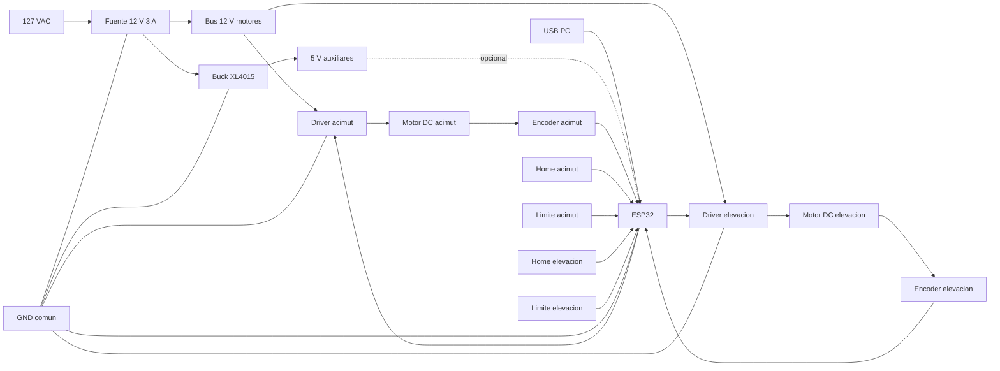
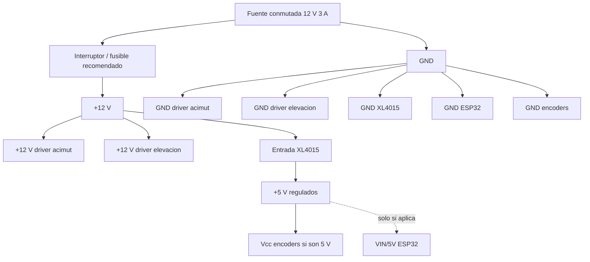
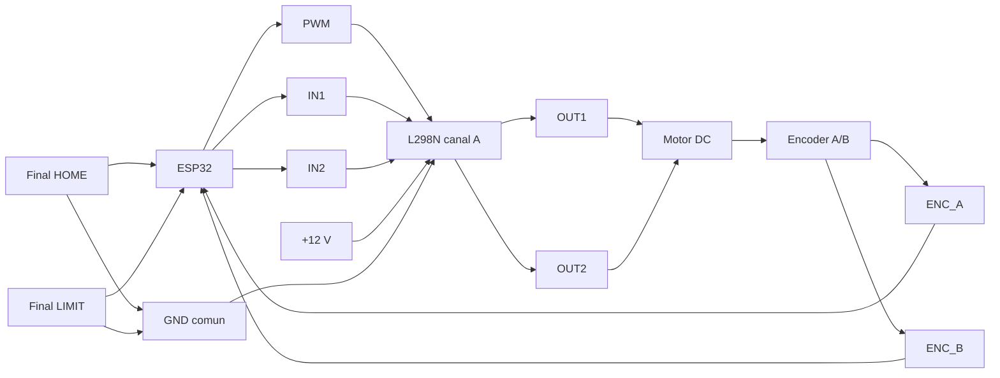
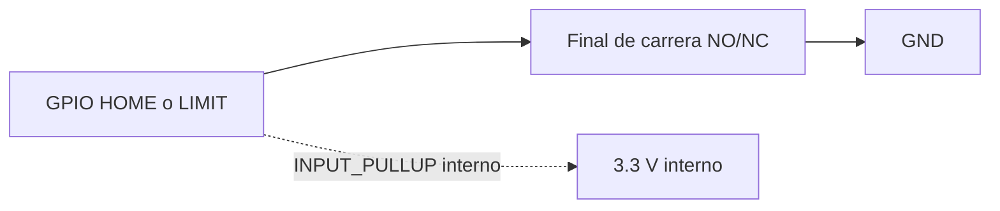
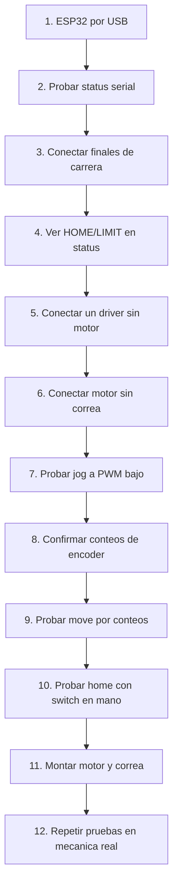

# Diagramas de electronica y control

Fecha: 2026-07-03.

Estos diagramas corresponden al MVP con ESP32, dos motores DC con encoder, dos drivers puente H, finales de carrera y fuente de 12 V. Se asume inicialmente driver tipo L298N por costo y simplicidad. Si se cambia a BTS7960/IBT-2, la arquitectura se mantiene, pero cambian las senales del driver.

## Archivos editables

Ademas de estos diagramas en Markdown/SVG, el proyecto ya tiene una version editable en KiCad:

- `electronics/kicad/mini_heliostato_mvp/mini_heliostato_mvp.kicad_pro`
- `electronics/kicad/mini_heliostato_mvp/mini_heliostato_mvp.kicad_sch`
- `electronics/kicad/mini_heliostato_mvp/export_svg/mini_heliostato_mvp.svg`

El esquema KiCad es de interconexion, no de PCB final.

## Diagrama general del sistema

Punto critico: el GND debe ser comun entre ESP32, fuente, buck, drivers y encoders. Si no hay tierra comun, las senales de encoder y control pueden fallar aunque cada modulo este alimentado.

## Distribucion de potencia

Durante pruebas de banco es preferible alimentar el ESP32 por USB y usar el buck solo para auxiliares. Aun asi, el GND del ESP32 debe conectarse al GND de la fuente de motores.

## Cableado por eje con L298N

Un L298N tiene dos canales. Para simplificar el cableado y reducir confusiones se puede usar un modulo L298N por motor, usando solo un canal por modulo. Si se quiere ahorrar, un solo L298N doble podria controlar ambos motores, pero se pierde margen termico.

## Pines propuestos

| Funcion | Acimut | Elevacion | Nota |
|---|---:|---:|---|
| PWM | GPIO 25 | GPIO 14 | Salida PWM al enable del driver. |
| IN1 | GPIO 26 | GPIO 12 | Direccion. |
| IN2 | GPIO 27 | GPIO 13 | Direccion. |
| Encoder A | GPIO 34 | GPIO 36 | Entrada solamente. |
| Encoder B | GPIO 35 | GPIO 39 | Entrada solamente. |
| HOME | GPIO 32 | GPIO 18 | `INPUT_PULLUP`, switch a GND. |
| LIMIT | GPIO 33 | GPIO 19 | `INPUT_PULLUP`, switch a GND. |

## Conexion de finales de carrera

Recomendacion: para pruebas iniciales usar el contacto normalmente abierto, de modo que al presionar el switch el pin lea `LOW`. Para montaje final puede convenir normalmente cerrado por seguridad: si se rompe un cable, el sistema lo detecta como falla/limite activo.

## Flujo de firmware MVP

```mermaid
stateDiagram-v2
    [*] --> Idle
    Idle --> Jog: comando jog
    Jog --> Idle: stop
    Idle --> MoveCounts: comando move
    MoveCounts --> Idle: conteos alcanzados
    MoveCounts --> Fault: timeout o limite
    Idle --> Homing: comando home
    Homing --> Backoff: HOME activo
    Backoff --> SlowApproach: retroceso corto
    SlowApproach --> Zero: HOME activo otra vez
    Zero --> Idle: encoder = 0
    Homing --> Fault: timeout
    Fault --> Idle: stop / reset manual
```

## Secuencia fisica de prueba

## Variante con BTS7960 / IBT-2

Si el L298N se calienta demasiado o pierde mucho voltaje, se puede cambiar a BTS7960/IBT-2. La potencia se conecta igual: 12 V, GND y motor. La diferencia esta en las senales de control:

| L298N | BTS7960 / IBT-2 equivalente |
|---|---|
| PWM + IN1 + IN2 | RPWM + LPWM + R_EN + L_EN |
| IN1 HIGH, IN2 LOW | R_EN HIGH, L_EN HIGH, RPWM PWM, LPWM 0 |
| IN1 LOW, IN2 HIGH | R_EN HIGH, L_EN HIGH, RPWM 0, LPWM PWM |
| PWM 0 | RPWM 0, LPWM 0 |

Para el MVP conviene iniciar con L298N si los motores se mueven sin esfuerzo. Si al montar el espejo hay calentamiento, falta de torque o caidas fuertes de voltaje, el reemplazo natural es BTS7960.

## Reglas de cableado

- Separar fisicamente cables de motor y cables de encoder cuando sea posible.
- Torcer pares de encoder A/GND y B/GND si los cables son largos.
- Poner capacitores pequenos en bornes del motor si aparece ruido electrico.
- No alimentar motores desde el 5 V del ESP32.
- No conectar 12 V al ESP32.
- Unir GND de todo el sistema en un punto claro.
- Probar un eje a la vez antes de conectar ambos.
